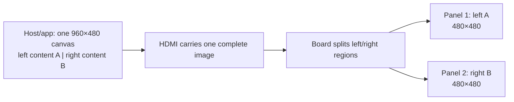
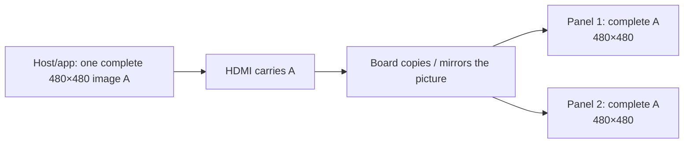

# Same-content and different-content dual screens: uses and driver-board logic

**English** | [简体中文](README.zh-CN.md)

For kits with one HDMI cable feeding a board connected to two panels. Check your order for same/different content and round/square shape. The current [2.1-inch](../../2.1inch-480x480-dual-nontouch/README.md) and [2.8-inch](../../2.8inch-480x480-dual-nontouch/README.md) kits each have two 480×480 non-touch panels. Exact shape/board assignments to earlier samples still need confirmation.

## What should the two screens show?

| Choose | Visible result | Suitable uses |
| --- | --- | --- |
| Same content | Both show the same complete picture, such as one promotion on both sides | Opposite viewers, repeated information, symmetrical decoration |
| Different content | Each shows a different part of one complete input canvas, such as instruments on the left and status on the right | Multiple metrics, primary/secondary information, coordinated dashboards |

**For these one-HDMI kits, same content repeats the full picture on both panels; different content uses a left/right picture prepared by the app, with one part on each panel.** Here, “mirroring” means duplicating the picture in the same reading orientation, not horizontally reversing the text.

## Which applications fit each choice?

These Raspberry Pi demos are implemented use cases, not proof that every size, shape or board has passed physical tests. The table does not establish that every configuration is sold for each size; check your order.

| Content / shape | Application | What the panels show |
| --- | --- | --- |
| Same / round | Music visualization | Identical colored spectra, sample track information and beat halos |
| Same / round | RGB ambience | Identical flowing rings and breathing effects on both sides of a desk or speakers |
| Same / round | Desktop clock | Identical time and sample weather for viewers on opposite sides |
| Same / square | Retail promotions | Identical products, sample prices and offer copy |
| Same / square | Meeting-room status | Identical availability/occupancy and demo countdown |
| Same / square | Parcel pickup | Identical sample shipment status and collection reference |
| Different / round | Flight instruments | Left attitude/heading; right airspeed/altitude |
| Different / round | Automotive instruments | Left speed/RPM/gear; right engine/fuel/voltage |
| Different / round | PC case | Left CPU/RAM; right GPU/cooling |
| Different / square | Smart home | Left environment/lighting; right solar/household power |
| Different / square | PC case | Left CPU/RAM/trends; right GPU/temperature/fans |
| Different / square | Industrial equipment | Left pump/pressure/flow; right trends/equipment status |

Product showcases use simulated data. The music demo neither captures nor plays sound. Weather, prices, calendars and shipments do not connect to real services automatically. Flight, vehicle and industrial pages do not establish real-device connection or control. Actual data integration requires the appropriate software and source separately.

## Why does each different-content panel show half a picture?

If one ordinary page fills a double-width canvas, splitting it gives each panel only part of that page. This can be the expected board behavior rather than missing pixels.

1. Confirm the product option and board input, not only the OS display number.
2. Prepare two complete views in the host application: one on the left, one on the right.
3. For two 480×480 panels, a supported side-by-side board can receive one 960×480 canvas: left 480×480 to panel 1, right 480×480 to panel 2. Use the actual board documentation and offered modes.
4. Check that each panel's borders and text are complete. Round layouts must keep important content inside the visible circle.

The board distributes pixels; it does not open two applications or redesign an ordinary page into two complete interfaces. If it still looks wrong, check cables/power and provide a photo of both panels, the host screenshot and the current input mode.

## Does same content also need two halves?

A hardware-copy board needs one complete picture, then duplicates it to both panels. For example, one 480×480 input can repeat on two 480×480 panels. Do not force 960×480 merely because there are two panels.

An SBS board can also show the same content through software: the application repeats the complete picture in both halves of a double-width canvas, and the board splits it normally. **Software duplication still uses the SBS double-width input; hardware copying uses a single-picture input.** Supported modes depend on the board. This does not imply interchangeable boards or a firmware conversion.

## Can Windows Duplicate/Extend switch the board mode?

One HDMI kit may correctly appear as one logical monitor. Windows Duplicate/Extend controls host outputs, not how this board splits or duplicates its input internally.

Start with [Windows Display settings](../../../platforms/windows/README.md) and the modes actually offered by the board. SBS requires a matching two-region layout; a hardware-copy board requires its matching single picture. Pi demo scripts do not run on Windows and do not establish Windows physical acceptance for these kits.

## Optional: run a three-use-case showcase on the Pi

<details>
<summary>Show four script families and requirements (not Windows)</summary>

Install the complete [dual-display app repository](https://github.com/tekgroaml/lvgl-embedded-gui-demos), v0.10.2 or a later compatible release. Follow its README for dependencies and signal requirements. Tested environment: Pi 4B, Bookworm Desktop 64-bit, labwc/Wayland. Use SSH as the ordinary user who owns the logged-in graphical desktop, without sudo.

| Family | Script | Sequence |
| --- | --- | --- |
| Same / round | ./demos/same/round/demo | Music → RGB ambience → clock |
| Same / square | ./demos/same/square/demo | Retail → room status → pickup |
| Different / round | ./demos/different/round/demo | Flight → automotive → PC case |
| Different / square | ./demos/different/square/demo | Home → PC case → pump |

Each chapter introduces the brand/use case for 3s, then runs the effect for 10s; 39s loop. Same-content introductions and effects are identical. Different-content introductions show brand/icon on the left and use-case/metrics on the right; effects show different information.

Example for a confirmed square hardware-copy board, from the complete app directory:

```bash
cd ~/apps/lvgl-embedded-gui-demos
./app --version
./app stop --port 1
./demos/same/square/demo check --port 1 --size 480
./demos/same/square/demo start --port 1 --size 480
```

Stop targets this project only; use another tool's own normal stop command if it occupies the output. Before upgrading, stop the old version using its existing code, then update the complete project rather than overwriting running files.

Same-content scripts default to `--signal clone` for hardware copying. For an actual SBS board supporting double-width input, add `--signal sbs` to both check/start. Do not change to another board's geometry or rate merely to pass validation. Specific recorded rates and evidence are in the [connection records](../../_unconfirmed/README.md); 480×480 per panel does not establish a universal 60Hz or other tested rate.

Public port 1/2 = Linux HDMI-A-1/2 = Pi 4 board HDMI0/1. This identifies the host connector, not the board's left/right panels. Change to `--port 2` if wired to connector 2.

Inspect or stop later:

```bash
./demos/same/square/demo status --port 1
./demos/same/square/demo stop --port 1
```

These app commands do not change timings, EDID, screen firmware or system mirroring, and do not restart the desktop. No timed rollback is provided. If check fails, verify the board/mode; failure does not create a missing mode. start runs in the background after SSH exits while the desktop stays logged in. Normal stop closes this project's window. Disconnecting/changing boards can end the app; reconnect stably and check/start again rather than assuming automatic recovery.

</details>

## How does the driver board process one picture?

<details>
<summary>Show split/copy logic and example input dimensions</summary>

“Driver” here primarily means the **hardware board and its firmware that drive both panels**, not a Windows driver you must install. The host sends one complete HDMI image; the board determines which pixels reach each panel. These examples describe the recorded side-by-side and hardware-copy boards; other arrangements follow their own board specifications.

### Different content: split one combined image



Input x=0…479 goes to panel 1; x=480…959 to panel 2, with y=0…479 for both. The application lays out A and B in one canvas beforehand; they are not two separate HDMI streams. Panel 1/2 denotes image regions here; check the physical left/right correspondence on the kit.

### Same content: duplicate one complete image



Both panels show complete A in the same orientation. “Mirror” here does not mean a horizontal flip. Hardware mode-switching capabilities depend on the board; Windows settings or app flags alone do not guarantee conversion from copying to different content.

### SBS software duplication: repeat first, then split

The host prepares `[complete A | complete A]` in a 960×480 canvas. The SBS board still splits left/right, so both panels receive A. Software repeats the content; hardware still splits regions. This differs from hardware copying a single 480×480 input.

These are picture-distribution explanations, not proof that all sizes/batches accept the example inputs or rates. They do not certify touch, Windows compatibility or physical scanout phase. Identical software frames are not physical synchronization/complete-picture acceptance. Historical sample evidence remains in the [connection records](../../_unconfirmed/README.md).

</details>

[2.1-inch dual-screen FAQ](../../2.1inch-480x480-dual-nontouch/README.md) · [2.8-inch dual-screen FAQ](../../2.8inch-480x480-dual-nontouch/README.md) · [Product index](../../README.md)
