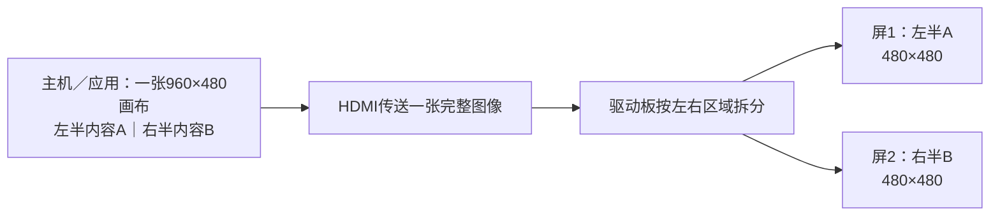
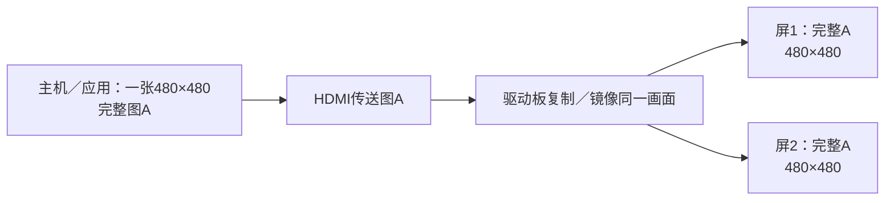

# 双屏同显与异显：用途、画面准备和驱动板原理

[English](README.md) | **简体中文**

适用于一根HDMI连接驱动板、再连接两块屏幕的双屏套装。先核对订单选择的是同显还是异显、圆形还是方形。当前[2.1英寸](../../2.1inch-480x480-dual-nontouch/README.zh-CN.md)和[2.8英寸](../../2.8inch-480x480-dual-nontouch/README.zh-CN.md)双屏均为每屏480×480、非触摸；具体形状／板卡与历史样机的对应关系仍需核对。

## 想让两块屏显示什么？

| 选择 | 两屏实际效果 | 适合的用途 |
| --- | --- | --- |
| 同显 | 两屏显示同一张完整画面，例如两边都显示同一条促销信息 | 对向观看、两侧重复信息、对称装饰 |
| 异显 | 两屏分别显示一张完整输入画布的不同部分，例如左仪表、右状态 | 多指标仪表、主信息与辅助信息、两页联动看板 |

**本系列一根HDMI带两屏：同显时两屏重复完整画面；异显时应用先准备左右两页，再分别显示到两屏。** 这里“镜像同显”指复制相同内容、保持正常阅读方向，不是把一块屏的文字左右翻转。

## 可以展示哪些应用场景？

以下是已经实现的树莓派演示内容，帮助选择产品用途。不是每个尺寸、形状、板卡都已完成实物验证，也不表示本页列出的配置全部作为商品选项出售；按订单选择匹配项。

| 显示关系／形状 | 应用场景 | 两屏内容 |
| --- | --- | --- |
| 同显／圆形 | 音乐律动 | 两屏相同的彩色频谱、示例曲目信息和节拍光环 |
| 同显／圆形 | RGB氛围 | 两屏相同的流动色环与呼吸效果，适合音箱／桌面两侧 |
| 同显／圆形 | 桌面信息钟 | 两屏相同的时间与示例天气，适合对向观看 |
| 同显／方形 | 门店促销 | 两屏相同的商品、示例价格和优惠文案 |
| 同显／方形 | 会议室状态 | 两屏相同的空闲／占用状态与演示倒计时 |
| 同显／方形 | 物流取件 | 两屏相同的示例包裹状态与取件参考码 |
| 异显／圆形 | 飞行仪表 | 左姿态／航向，右空速／高度 |
| 异显／圆形 | 汽车仪表 | 左车速／转速／挡位，右发动机／油量／电压 |
| 异显／圆形 | PC机箱 | 左CPU／内存，右GPU／散热 |
| 异显／方形 | 智能家居 | 左室内环境／灯光，右光伏／家庭用电 |
| 异显／方形 | PC机箱 | 左CPU／内存／趋势，右GPU／温度／风扇 |
| 异显／方形 | 工业设备 | 左泵站／压力／流量，右趋势／设备状态 |

这些产品展示使用模拟数据。音乐演示不采集或播放声音，天气／价格／日历／物流也不自动连接真实服务；汽车、飞行和工业页面不代表已接入或控制真实设备。真实数据接入需要对应软件和数据源另外实现。

## 为什么异显看到的是半张图？

如果原本把一张普通完整页面铺在双宽画布上，驱动板拆开后，每个面板就只显示其中一部分。这符合异显板的分区逻辑，不一定是缺边故障。

1. 先确认订单及驱动板输入要求，不仅看系统的显示器编号。
2. 异显要在电脑／应用端准备好左右两区：左边完整设计一页，右边完整设计另一页。
3. 以本系列每屏480×480举例，支持左右分区的板通常使用一张960×480画布；左480×480给屏1，右480×480给屏2。实际输入仍以该板资料和系统提供模式为准。
4. 检查两屏各自的边框和文字是否完整；圆形内容要放在可见圆内。

驱动板负责分配像素，不会自动打开两个应用，也不会把普通程序重新排版成两个完整页面。仍异常时，先检查接线、供电，再提供两屏照片、主机画面截图和当前输入模式。

## 同显是不是也要把一张图分成两半？

硬件同显板不需要用户准备两套页面：主机给一张完整画面，板子把这张画面复制给两块屏。例如480×480单幅输入可以给两块480×480屏重复显示；不要仅因有两个面板就强制设置960×480。

SBS异显板也可以用软件做出同显：应用先把同一幅画面分别放到双宽画布的左右区，再由板子正常拆分。**这种软件同显仍使用SBS的双宽输入，与硬件同显板的单幅输入不同。** 能否这样用要看板卡支持的模式，不代表两种板可以任意互换或刷固件转换。

## Windows里选“复制／扩展”能直接切换吗？

一根HDMI只作为一个逻辑显示器被系统识别，可以是正常现象。Windows“复制／扩展”针对的是主机的多个输出，不负责改变这块驱动板内部的分图／复制方式。

先用[Windows显示设置](../../../platforms/windows/README.zh-CN.md)查看该板实际提供的分辨率。SBS需要支持左右分区的画面布局；同显板需要与其匹配的单幅画面。这里的树莓派演示脚本不能在Windows运行，也不代表该套装已完成Windows实体验收。

## 可选：在树莓派运行三场景演示

<details>
<summary>展开四类脚本与使用条件（不适用于Windows）</summary>

安装完整[双屏应用仓库](https://github.com/tekgroaml/lvgl-embedded-gui-demos)，使用v0.10.2或后续兼容版，按其README确认依赖和输入。测试环境为Pi4B、Bookworm Desktop 64位、labwc/Wayland。以已登录图形桌面的同一普通用户在SSH运行，不加sudo。

| 类型 | 脚本 | 三场景顺序 |
| --- | --- | --- |
| 圆形同显 | ./demos/same/round/demo | 音乐→RGB氛围→信息钟 |
| 方形同显 | ./demos/same/square/demo | 门店→会议室→取件 |
| 圆形异显 | ./demos/different/round/demo | 飞行→汽车→PC机箱 |
| 方形异显 | ./demos/different/square/demo | 家居→PC机箱→泵站 |

每组先介绍品牌与场景3秒，再演示10秒，共39秒循环。同显介绍与效果两屏相同；异显介绍左屏品牌／图标、右屏用途／指标，效果各显不同内容。

例如，确认是方形硬件同显板后，在完整应用根目录执行：

```bash
cd ~/apps/lvgl-embedded-gui-demos
./app --version
./app stop --port 1
./demos/same/square/demo check --port 1 --size 480
./demos/same/square/demo start --port 1 --size 480
```

停止命令只针对本项目；若其他工具占口，先用其自身的正常stop命令。升级前要先用旧版本停止，再更新完整项目，不能覆盖运行中的程序。

同显脚本默认`--signal clone`，对应硬件复制；若实际为支持双宽输入的SBS板，check/start都显式加`--signal sbs`。不要为了通过检查而改成另一块板的分辨率或刷新率。四类连接的具体速率和证据见[连接记录](../../_unconfirmed/README.zh-CN.md)，不能从每屏480×480推断通用60Hz或某个已测速率适用。

公共端口1/2=Linux HDMI-A-1/2=Pi4板标HDMI0/1，指主机HDMI接口，不是驱动板的左／右面板。示例为接口1，接口2接线时改为`--port 2`。

检查或稍后停止：

```bash
./demos/same/square/demo status --port 1
./demos/same/square/demo stop --port 1
```

这些应用命令不修改时序、EDID、屏幕固件或系统镜像设置，不重启桌面、无定时回退。check不匹配时先核对板卡和模式；失败不会创建缺失模式。start后台运行，SSH退出后继续，前提是桌面保持登录；正常stop关闭本项目窗口。拔线／换板可能使程序退出，重新连接稳定后再check/start，不能假设自动恢复。

</details>

## 驱动板如何处理一张图？

<details>
<summary>展开异显拆图、同显复制与输入尺寸示意</summary>

这里的“驱动”主要指**连接两个面板的硬件驱动板及其固件**，不是要求安装一个Windows驱动程序。主机显卡输出一张完整HDMI图像，板卡决定把哪些像素送给每个面板。以下以已记录的左右分区和单幅复制板为例；其他排布以实际板卡说明为准。

### 异显：一张合成图，拆成两部分



输入像素x=0…479分给屏1，x=480…959分给屏2，纵向均为0…479。A和B由应用事先排在同一画布中；不是两根独立HDMI流。屏1／屏2在这里指画面分区，实物哪边对应哪区需现场核对。

### 同显：一张完整图，复制到两个屏



两块屏都显示完整A，方向一致。“镜像”在本说明中不是水平翻转。是否具有硬件模式切换功能取决于板卡，不能仅凭改Windows设置或应用参数保证同显板变成异显板。

### SBS软件同显：先重复，再拆分

主机准备`[完整A｜完整A]`的960×480画布，SBS板仍按左右两半拆分，结果两屏都是A。软件负责重复内容，板卡仍是分区逻辑；与单幅480×480输入的硬件复制不同。

这些是画面分配原理，不证明任何尺寸／批次都接受示例输入或具有相同刷新率，也不证明触摸、Windows兼容性或实体扫描相位。相同软件画面不等于已经完成两块实物的同步和完整性验收。历史样机证据单独保留在[各连接记录](../../_unconfirmed/README.zh-CN.md)。

</details>

[2.1英寸双屏FAQ](../../2.1inch-480x480-dual-nontouch/README.zh-CN.md) · [2.8英寸双屏FAQ](../../2.8inch-480x480-dual-nontouch/README.zh-CN.md) · [产品目录](../../README.zh-CN.md)
